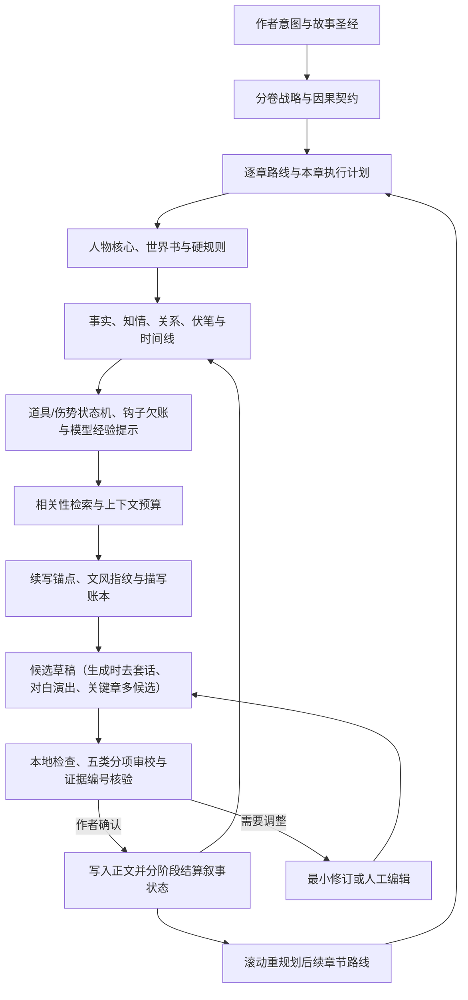

<div align="center">

# 砚火 · InkForge Local

### 为中文长篇小说而生的本地 AI 写作工作台

从一句灵感，到故事圣经、分卷规划、逐章创作、连续性审计与长期记忆——<br>
让本地模型真正参与一部长篇作品的完整生产，而不只是续写下一段文字。

[](https://github.com/star031104/inkforge-local)
[](https://github.com/star031104/inkforge-local/actions/workflows/tests.yml)
[](https://github.com/star031104/inkforge-local/releases/latest)
[](https://www.python.org/)
[](https://fastapi.tiangolo.com/)
[](#模型建议)

**中文长篇 · 同人 Canon Lock · 证据知识图谱 · 可恢复工作流 · 读者模拟与网文导出 · 作者最终控制**

[下载安装](#下载安装) · [快速开始](#快速开始) · [核心能力](#核心能力) · [创作工作流](#推荐创作工作流) · [技术架构](#技术架构) · [开发验证](#开发验证)

</div>

---

## 项目简介

**砚火**是一套面向中文长篇与同人创作的 AI 写作工作台。模型接入只需要一个 OpenAI 兼容的接口地址：填写 Base URL 与可选的 API Key，测试连通后从服务返回的模型列表中选择写作模型；需要时还可以从同一接口再选一个模型专门负责规划、审校和记忆提取。本地 llama.cpp、vLLM、Ollama 与各类云端兼容服务都可以直接使用。

它不会把整本小说粗暴地塞进一次提示词，也不会让模型悄悄覆盖手稿。作品方向、人物状态、世界规则、伏笔、章节计划和历史版本都以结构化数据留在本机；生成内容先进入候选草稿，只有作者确认后才写入正文并更新长期记忆。

> 砚火不是“替你按一下按钮写完一本书”，而是让 AI 在长篇创作中拥有可靠的规划、记忆、审计与恢复能力，同时始终保留作者的决定权。

## 项目状态

| 项目 | 当前状态 |
| --- | --- |
| 当前版本 | `0.34.0` |
| 支持系统 | Windows 10 / 11；源码模式同时支持 Linux |
| Python | 3.10–3.12；自动部署版无需预装 |
| 数据存储 | 本地 SQLite，作品与模型凭据分库保存 |
| 模型接口 | 一个自定义 OpenAI 兼容 Base URL（本地或云端均可） |
| 模型选择 | 测试连通后从列表选择写作模型，可另选规划审校模型 |
| 自动化测试 | 415 项；Windows / Linux × Python 3.10 / 3.12；从不读写 `data/` |
| API 兼容版本 | `52` |

## 下载安装

前往 [GitHub Releases](https://github.com/star031104/inkforge-local/releases/latest) 下载最新版。

| 发行方式 | 适合场景 | 使用方法 |
| --- | --- | --- |
| `InkForge-Deploy-0.34.0-win64.zip` | 推荐给普通 Windows 用户，下载体积小 | 解压后双击 `InkForgeLauncher.exe`，首次运行自动准备环境 |
| `InkForge` 便携目录 | 完全离线机器或需要固定运行环境 | 解压完整目录后运行 `InkForge.exe` |
| 源码运行 | 开发、调试、二次开发 | 克隆仓库后运行 `run.bat` 或 `run.ps1` |

> 首次自动部署需要联网下载 Python 和锁定依赖。下载完成后会复用本机缓存；作品、凭据、日志和备份不会写入程序安装目录。

## 为什么选择砚火

| 常见问题 | 砚火的解决方式 |
| --- | --- |
| 长篇写到后面人物失忆、设定漂移 | 可追溯事实、人物知情、关系、伏笔与事件时间线共同约束 |
| 大纲很宏大，拆到章节却反复做同一件事 | 分卷因果契约、可选叙事策略与跨章重复检查；保留经典十二岗位模式 |
| 本地小模型容易超时或输出残缺 JSON | 分段事务、流式闭合早停、检查点恢复与可编辑降级结果 |
| AI 草稿出现套话、复述、截断或现代术语 | 生成时去套话 + 五类分项审校 + 证据编号核验 + 全稿级质量体检 |
| 写到中后段忘了自己埋的钩子、道具和伤势 | 钩子欠账、道具/伤势状态机与滚动重规划共同跟踪 |
| 不知道读者会在哪里弃读 | 模拟读者逐段给出兴趣、困惑与预测，再对照作者计划 |
| 自动生成中断后必须从头再来 | SQLite 持久化任务状态，可暂停、恢复并从首个问题点重建 |
| 深度规划和正文对模型要求不同 | 同一接口可分别选择写作模型与规划审校模型，也可一个模型处理全部任务 |
| 同人角色越写越 OOC | 原作资料库 + 人工核对 Canon Profile + 接受前 Canon Gate |
| 参考小说越学越像“复制” | 抽象风格指纹 + 多样文分析 + 长原句重合检测 |

## 核心能力

### 统一运行时与一键部署

- **统一应用入口**：源码、命令行、便携版和自动部署版共用同一套服务启动、日志、端口和健康检查逻辑。
- **双击自动部署**：独立启动器检测 Python 与依赖，必要时从官方固定地址下载并校验安装，完成后自动打开工作台。
- **隔离运行环境**：依赖环境同时绑定应用版本和依赖文件指纹，升级不会污染旧环境；缓存完整时可以离线复用。
- **发布契约检查**：应用、前端资源、启动器、安装脚本和文档版本必须一致，CI 与本机构建都会阻止错配发布。
- **周期数据库备份**：备份任务跟随应用生命周期运行，与具体保存按钮解耦；自动和手动备份分别轮换。
- **正式项目元数据**：`pyproject.toml` 统一声明构建后端、Python 版本、运行依赖、开发依赖和 `inkforge` 命令入口。

### 专业工程与作者工作台

- **清晰分层**：HTTP 请求契约与路由位于 `app/api`，纯故事规则位于 `app/domain`，业务用例位于 `app/services`，SQLite 与检索实现位于 `app/infrastructure`，运行配置集中在 `app/core`。
- **可组合路由**：作品生命周期、系统状态、模型发现、资料研究、专业工作台和场景工作台分别注册；入口文件负责组合，不再拥有这些接口的实现。
- **前端职责拆分**：项目状态、生成、设置、规划、资料、审校、治理、自动导演、场景工具和启动绑定均为独立脚本；样式也按基础、工作区、模型路由和写作工具拆分。
- **兼容迁移**：HTTP 路径、项目 JSON 和 SQLite 数据格式保持兼容；原有 `app.main` 入口和关键测试导入继续有效。

- **章节时间边界**：正文提示词、章节规划和审计按当前章之前的证据构建记忆视图；摘要、动态人物状态、关系和事件不再直接使用全书最终状态。作者预先设定的世界观和大纲仍可作为规划资料。
- **修改后的记忆重建**：已结算正文变更会标记受影响章节及后文记忆失效，隔离旧事实并提示按顺序重新结算。正文保留；新结算与正文哈希一致时只使后续章节失效。
- **证据门禁**：高、中严重度问题缺乏有效证据时保留“待复核”，不会因机械检查高分而自动通过。规则分、连续性复核状态和文学判断分开表达。
- **保存冲突保护**：界面与专业工作台写入必须携带作品版本；数据库更新原子比较版本。冲突返回明确提示，无修改保存不制造新版本。
- **场景工作台**：在正文上方新建场景计划，或先选中正文再绑定场景；支持视角、时空、进入状态、目标、阻力、变化、退出状态和依赖事实。卡片编辑不修改正文，单场生成仍进入候选稿。原文变更或绑定重叠时要求重新定位。
- **叙事策略与作者偏好**：在“规划”中选择因果与人物、悬疑、关系、冒险、观察、自定义或经典十二岗位。偏好先保存为待确认项，明确启用后才进入正文生成上下文，可随时停用；允许保存修改前后实例供作者复核。
- **候选稿取舍**：重写、扩写支持按变化片段选择采用或保留原文，先组合新候选稿，再通过原有插入流程写入正文；变化后旧审计结果失效。
- **Skill 适用性**：任务、题材和排除条件共同决定适用性，手动选择也遵守边界；提示词预览标记注入与裁剪情况。Skill 是受约束的写作方法，不是可执行代理。
- **本地调用记录**：查看最近调用的模型、任务、重试、耗时、结束原因和 token 来源；仅存统计，不存正文、提示词、接口地址和密钥。无供应商用量时显示估算，不虚构费用。
- **候选评测**：并排比较两份稿件的机械问题、句长与对白占比，可导出记录。此功能不调用模型、不自动选稿，也不声称能评判文学质量。
- **最终请求预算检查**：发送模型前核对包含稳定前缀的完整输入与输出预留，超限先提示调整。仍使用估算，实际分词由模型决定。
- **增量检索索引**：仅更新变化的检索文档；重建索引时剔除失效与孤立的派生事实。作品 JSON 仍是事实源。

旧作品缺少人物初始状态或历史证据时，无法可靠还原的动态字段会暂时留空；请核对后补充设定，并从提示的失效章节顺序重建记忆。

### 全书级规划

- **灵感孵化**：把一句人物、冲突或片段扩展成两套可比较的开书方案。
- **故事圣经**：建立主题命题、读者承诺、故事发动机、贯穿冲突与终局代价。
- **分卷蓝图**：按卷固定主要场域、时间跨度、人物选择、不可逆变化和新故事问题。
- **逐章因果路线**：以小批次拆章，检查目标、冲突、转折、章末变化及卷内推进职责。
- **一键创作全文**：从灵感开始，自动完成规划、拆章、正文、审计、修订与记忆回灌。

### 长期叙事记忆

- 章节正文先持久化为 `settlement_pending`，再提取、核验和提交；失败只会进入 `state_degraded`，不会丢正文。
- **分阶段记忆提取**：摘要、事实、人物、关系、伏笔等分成多个小阶段调用，共享正文前缀以利用前缀缓存；截断时减半条目重试，可选阶段失败只留空并告警。之后“补提取”只重跑失败的阶段，已结算部分保持不变。
- **道具与伤势状态机**：关键道具（持有 / 遗失 / 损毁）和伤势以按章编号的事件日志保存，任意章节的状态由此前事件折叠得出，防止已丢失的兵器再次出鞘、重伤下一场就被遗忘。
- **钩子欠账**：每章接纳时记录计划中的章末钩子，后续章节审校逐条判定兑现 / 推进 / 未处理；超出窗口仍未处理的钩子成为“钩子债”，注入下一章写作上下文，长期无人理会会自动过期。账本按章节 ID 记录，插入或删除章节不会错位。
- 每次验收绑定正文 SHA-256，同一正文重复点击不会制造重复事实，正文改变后旧记忆提交会被拒绝。
- 永久人物核心与动态场景状态分离，临时衣着不会覆盖稳定外貌。
- 原子事实、人物状态、知情、关系、时间线和伏笔更新必须附正文连续证据，并在本地逐字核验后才能升级为权威状态。
- 模型返回的全书摘要只保存为候选；实际滚动进展由已接纳章节摘要确定性汇编，不能被单次模型响应整体覆盖。
- 独立维护人物知情账本、动态关系网、事件时间线与伏笔生命周期。
- 世界书支持关键词或正则触发、AND/NOT 条件、递归关联、作用域和 token 预算。
- 相关性检索把结构化状态与 SQLite FTS5 旧正文片段混合排序，并使用类型配额和相似内容抑制，避免同类旧信息挤占上下文。
- 检索查询在数据库层排除当前章与未来章；FTS 索引属于可重建投影，项目 JSON 始终是唯一事实源。
- 作者层真相、读者已见信息和人物有证据知情分别编译；重写早期章节时不会注入本章或后期知情账本。

### 写作与文风控制

- 支持续写、按要求创作、重写选中内容、扩写选中内容。
- 续写、新章、局部改写和整章修订采用不同上下文配方；局部改写不会再加载无关的全书战略。
- 创作自由度可选严格、平衡或探索；三种模式都保护权威事实与人物知情边界。
- 续写时锚定原文末句和场景边界，降低复述、重开场景与凭空补史。
- 文风学习采用“风格卡 + 合法样文节选”的软学习方式，不修改模型权重。
- 根据当前场景的对话比例、句长、节奏和相关性动态选择文风示例。
- **生成时去套话**：在 llama.cpp 上对“深吸一口气”“嘴角勾起”等套话的特征 token 施加负 `logit_bias`；所有接口都会在成稿后只把命中的句子连同前后各一句交给模型做一次小范围改写再拼回，不整章重写。作者禁用词零容忍，通用套话每稿允许一次。
- **对白演出**：主要角色各自以第一人称即兴演出本场，只能看到自己的档案、声纹样本和截至本章的知情范围；结果作为“对白演出素材”注入正文提示词，越过知情边界的台词会被本地过滤。
- **关键章多候选**：开篇、高潮和计划标记的关键章可生成 2–3 份候选稿，先做本地确定性筛查，再由规划模型做 A/B 两种顺序的成对盲评，两次结论一致才算胜出；全部候选保留在检查点中供作者查看。

### AI 自动创作与精修

- **一键创作全文**：从一句灵感开始，自动完成开书、人物与世界设定、全书规划、分卷拆章、逐章正文、审校修订和记忆回灌。
- **AI 自动精修**：可以只处理精修队列，也可以检查全部已有正文；逐章执行审校、整章修订、重新审校、硬契约扫描、正文锁定和记忆更新。
- **多轮自动修订**：每章可自动尝试 2–4 次，达到目标质量分后才接纳；不达标的候选稿保存在检查点中，不覆盖原正文。
- **后台检查点**：自动创作和自动精修都可暂停、恢复；关闭浏览器后任务仍由本地服务继续执行。
- **人工控制**：单章审校结果支持“一键修订全部问题”，也可以只选择部分问题修订并随时撤销。
- **滚动重规划**：每章结算后按实际写出的内容重新规划后续 3 章（可调）的目标、冲突、转折和章末钩子；不改分卷契约，跳过作者编辑或锁定的路线与已有正文的章节，校验变差即回滚，改动以字段级差异记入任务日志。
- **精修收敛保护**：连续多轮精修发布分几乎不动或反复卡在同样的未通过项时，任务以 `needs_author` 停下并列出未解决问题，不再空转消耗模型调用；作者处理后可重新启动或强制运行。
- **单次运行审校预算**：启动一键创作时可为本次任务单独选择审校预算（自动 / 全量 / 轻量），默认跟随作品设置。
- 逐章作者注只约束当前章节，长期硬规则与临时要求互不污染。
- 写作 Skills 分为内置只读、个人跨项目和项目随书三层，支持始终、关键词自动和手动激活。
- Skill 只能提供受长度限制的提示词方法，不能执行命令、调用工具、访问文件或联网，也不能覆盖事实与知情边界。

### 原作同人角色与证据知识图谱

- **Canon Lock**：为时崎狂三、花火、上杉绘梨衣等原作角色保存原作、时间节点、人格、价值观、能力限制、语言/行为/情绪模式和禁止 OOC 清单。
- AI 可根据上传的原作资料生成“待核对档案”，**只有人工确认后才成为最高级角色硬约束**。
- 正文接受前可强制运行 Canon Gate；明显 OOC、无铺垫关系突变或高风险样文复刻会阻止入稿。
- **知识层不是把共现当关系**：结构化事实和关系保留来源/证据，候选推断不会自动升级为真相。
- 可变状态支持 superseded：角色移动后，旧“当前地点”不会继续和新地点同时注入。
- 知识图谱是可重建的检索投影，人物卡、世界书和已接受正文仍是事实源。

### 专业工作台：考据、事件溯源与不可覆盖定稿

- 联网检索与大模型完全解耦，可选免密钥 Bing RSS / Wikipedia、SearXNG 或 Brave Search；不依赖 Grok，也不需要浏览器接管。
- 来源按 S/A/B/C/D 分级；人物事实拆成原子结论，证据必须能在保存的来源正文中逐字定位，推断与原作明确内容分开保存。
- 角色档案由已批准结论汇总，保留来源、冲突和待人工确认状态，不让一次模型回答直接成为正典。
- 人物变化和关系变化以事件日志保存，并能确定性重建当前状态；信任、距离、立场和信息差不再只靠滚动摘要维持。
- 角色声纹实验室保存有出处的正反样本和句长、对白率等统计约束，只学习规律，不复制原句。
- 候选稿、审校报告、修订提案和最终定稿分别留档；最终定稿绑定内容哈希与权威资料版本，同一候选稿不能被二次覆盖。
- 人物卡、世界书、规划、风格或考据资料改变时自动提高权威版本，并把依赖旧版本的派生资产标为过期。
- 模型接入只有一个 OpenAI 兼容地址；写作类任务使用写作模型，规划、审校、提取与研究使用规划审校模型（未单独选择时与写作模型相同）。

### 多文件参考资料库

- 支持 TXT / MD / DOCX / EPUB / PDF / HTML 等文本资料。
- 资料分类为：**文风样文 / 原作正典 / 世界背景 / 研究资料**。
- 文风分析只消费“文风样文”，人物正典分析只消费“原作正典”，避免职责混淆。
- 支持多篇样文聚合分析，并对候选正文做长片段精确重合检查。

### 审计与质量系统

- 检查长度、元话语、Markdown、重复原文、循环措辞、AI 套话与疑似截断。
- 审计人物人格、声音、知识来源、关系、道具、伤势、位置、时间与世界规则。
- 识别跨章原句或段落复用、疲劳词、章节相似度和分卷阶段雷同。
- **时代用语门禁**：历史题材统计现代术语密度；可维护术语白名单，并设置“主角可使用现代词汇”（自动推断穿越、重生等设定），允许时叙述中的术语按 1/3 计入、对白照常计入。
- **五类分项审校**：按 ConStory 分类把连续性问题拆成人物记忆与能力、事实细节、视角与语气、时间线因果与弃坑、世界规则与地理五个小审校器，各自只看所需上下文；也可切回单一审校。
- **风险分级审校预算**：自动模式先按本章风险信号打分，低风险章节合并为一次审校，高风险章节逐项细审，合并审校发现需升级的问题或调用失败时自动改为逐项细审；也可固定为全量或轻量。
- **证据编号定位**：审校稿按“段-句”编号，模型引用编号而非复述原文；本地按编号取原句，其次精确匹配，再次模糊匹配（阈值 0.9），存档引文始终是原稿文字并绑定稿件哈希。
- **模型经验库**：按模型统计经证据核验或本地检测出的反复问题，至少在两个不同章节出现才会变成下一次生成的固定模板提示，权重随章节衰减；模型原话不会进入写作提示词。
- 审计建议可逐项选择并执行最小修订，不直接覆盖已确认正文。

### 质量评测

- 长篇评测脚本 `scripts/evaluate_longform.py` 可生成基准作品或离线评分已有作品，并比较两次运行。
- 确定性指标包括冲突率、套话率、弃坑率、提取截断率、审校/正文 token 比与 ConStory 19 个子类问题分布。
- **终局窗口**：检测仍覆盖全书，但单独统计落在全书最后一段文字里的冲突率与 ConStory 问题密度，暴露“越写到结尾越崩”。
- **机器味信号**：按窗口计算字与双字词的类型/词次比、3–5 字片段重复率和句长离散度，只用于比较同一流程的不同运行，不是 AI 检测器。
- **成对盲评**：匿名 A/B 两种顺序各评一次，两次一致才计入，结果与确定性指标分开报告。

### 导入、可视化、读者与发布

- **导入旧稿续写**：TXT / MD / DOCX / EPUB 旧稿自动拆章并作为作者正文锁定；规划模型分批反推人物、世界书和伏笔候选，作者勾选确认后才写入作品，再逐章结算记忆，可暂停和恢复。
- **人物关系图与伏笔时间线**：从权威状态只读投影人物关系网、事件时间线和伏笔生命周期，支持“截至第 N 章”视图，并提示超过 15 章未回收的伏笔。
- **读者模拟**：老读者、新读者、挑剔书评人三种模拟读者只读已写出的正文，给出逐段兴趣曲线、弃读点、困惑与预测，再与作者计划对照找出被猜中的转折和没解释的困惑。最多 12 章可在后台运行，全进程共用最多 3 个并发模型调用；服务重启后中断的任务可“继续”，已保存报告的章节会跳过。
- **网文导出与连载节奏**：仅用标准库导出 TXT / EPUB / DOCX；连载管理记录每日更新量、发布时间、休息日和逐章发布状态，计算存稿、连更天数和预计完结日期，状态不写入稿件 JSON。
- **深色主题**：界面支持跟随系统、宣纸（浅色）和墨夜（深色）三种主题。

### 本地可靠性与数据安全

- SQLite 使用 WAL 与写入等待保护，自动维护数据库备份。
- 章节验收采用可审计提交状态；耗时提取期间会从服务器最新项目合并，避免覆盖其他章节的并行编辑。
- 每章在保存、接纳草稿和自动导演写入前保留独立快照。
- 完整项目可导出并重新导入为独立副本。
- 长任务绑定发起时的作品和章节，切换页面不会把结果串写到其他章节。
- 保存使用服务器版本校验；另一个窗口或后台任务更新作品后，旧窗口只能导出副本或重新载入，不能静默覆盖新版本。
- 草稿记录生成时正文与选区；正文在生成期间发生变化时会停止应用，并提供原文与候选稿对比。
- 自动导演支持暂停、恢复、严格模式和无人值守质量债务模式。
- 每次正文生成自动冻结实际模型消息、检索来源、Skill、预算裁剪和提示词 SHA-256；可在界面审计并用新的模型配置回放。
- 快照不会保存 Provider 凭据，凭据字段和疑似 API Key 在入库前统一脱敏。

## 长篇防跑偏机制

砚火通过多层上下文与状态控制维持长篇一致性：



提示词预览会展示每个上下文区块的优先级、估算 token、FTS/词法记忆来源、激活的写作 Skills 及预算裁剪轨迹，并可冻结为可审计快照。

## 快速开始

### 环境要求

- Windows 10 / 11
- 一个可访问的 OpenAI 兼容模型服务（云端服务的 API Key，或已经启动的本地 llama.cpp / vLLM / Ollama）

使用自动部署版不需要预装 Python。源码开发需要 Python 3.10 或更高版本。

### 1. 启动砚火

普通使用直接解压 `InkForge-Deploy-0.34.0-win64.zip`，双击
`InkForgeLauncher.exe`。启动器会检测运行环境；缺失时自动下载经过固定哈希校验的
Python 和项目依赖，完成后打开工作台。运行环境、日志与作品数据位于当前用户的
`%LOCALAPPDATA%\InkForge`，更新程序目录不会覆盖作品。

源码开发方式：

```powershell
git clone https://github.com/star031104/inkforge-local.git
cd inkforge-local
.\run.bat
```

访问 **http://127.0.0.1:7860**。首次启动会自动创建虚拟环境并安装依赖。`run.bat` 只对本次子进程使用 PowerShell `ExecutionPolicy Bypass`，不会永久修改系统执行策略。

### 2. 配置模型接口

打开右上角 **模型设置**，只需要三步：

1. 填写 **Base URL**，即服务的 OpenAI 兼容地址。可以带或不带 `/v1`，例如 `http://127.0.0.1:8080`、`http://127.0.0.1:8080/v1`、`https://api.example.com/v1`；误粘贴的 `/chat/completions` 后缀会被自动去掉。
2. 填写 **API Key**（本地服务可留空），点击 **测试连通**。砚火会读取服务的 `/models` 列表、显示延迟，并识别服务类型（llama.cpp、vLLM、Ollama 或通用服务）及其支持的扩展参数。连接失败时会用中文说明原因，例如 Key 无效、地址缺少 `/v1` 或服务未启动。
3. 从下拉列表选择 **写作模型**（正文、续写与修订）。如果希望规划、审校与记忆提取用另一个模型，勾选“使用另一个模型”后从同一列表选择。服务不提供模型列表时，可选择“手动输入模型 ID”。

```text
Base URL: http://127.0.0.1:8080/v1      # 或任意云端兼容地址
API Key : 可留空（本地）/ 服务提供的 Key
写作模型: 从列表选择
规划审校: 默认与写作模型相同，可另选
```

Top K、Min P、重复惩罚、前缀缓存、JSON Schema 约束和短语抑制等扩展参数，只会发送给测试时识别为支持它们的服务（例如 llama.cpp），通用服务只收到标准 OpenAI 参数。

> API Key 也可以通过环境变量 `INKFORGE_API_KEY` 提供，这样密钥不会进入项目数据库。在界面中填写的 Key 只加密保存在本机凭据库，导出项目 JSON 时会自动移除。旧版的 `ZHIPU_API_KEY`、`MODELSCOPE_API_KEY`、`INKFORGE_OPENAI_COMPAT_API_KEY` 仍作为兼容后备读取。

### 3. 使用本地 llama.cpp

先启动本地模型，例如：

```powershell
llama-server.exe `
  -m D:\Models\your-model.gguf `
  --host 127.0.0.1 `
  --port 8080 `
  -c 32768 `
  -ngl 99
```

然后在模型设置中把 Base URL 填为 `http://127.0.0.1:8080`，点击测试连通并选择模型即可。建议在高级参数中保持“启用模型思考”关闭。

### 从旧版本升级

0.33 及更早版本的“智谱 / ModelScope / 本地 llama.cpp / OpenAI-Compatible”服务选择会在打开作品时自动迁移为对应的 Base URL，原模型 ID 与已保存 Key 保持不变。旧的两个模型若使用同一接口，第二个模型会成为规划审校模型；若两个模型来自不同接口，则保留模型 1 的接口（只有模型 2 配置了 Key 时改用模型 2）。无需重新建立项目，原有角色、世界观、样文、知识图谱和章节记忆全部继续使用。

## 推荐创作工作流

### 专业分层创作

1. 在“灵感孵化”输入一句想法，从两套方案中选择更有潜力的方向。
2. 生成并审核故事圣经、人物卡、世界书、分卷契约与详细蓝图。
3. 逐卷生成章节因果路线，再批量建立或同步章节。
4. 为当前章节生成执行计划，明确开篇第一拍、场景因果拍和章末状态。
5. 生成候选草稿，执行质量检查和连续性审计。
6. 选择问题进行最小修订，确认后插入正文并更新长期记忆。
7. 定期运行项目体检，处理重复内容、线索债务和记忆来源问题。

### 全文自动导演

如果希望从一个灵感直接开始整本生产，可使用“一键创作全文”。系统会串行执行：

```text
灵感 → 故事骨架 → 人物卡与世界书 → 故事圣经
     → 分卷契约 → 逐卷蓝图 → 逐章路线
     → 本章计划 → 正文 → 审计 → 修订 → 记忆回灌
```

自动导演针对本地 8–12B 模型采用细粒度检查点。模型断开、持续超时或结构化输出无法闭合时会安全暂停；软质量问题则保留最佳完整候选、记录质量债务并按所选模式继续。重启应用后可从最近检查点恢复。

## 技术架构

```text
inkforge-local/
├─ app/
│  ├─ main.py                 应用组合、章节与规划工作流
│  ├─ entrypoints/            源码、桌面版和部署版共用的进程入口
│  ├─ api/                    请求契约与按业务区域拆分的 HTTP 路由
│  ├─ core/                   版本、运行路径与无副作用基础工具
│  ├─ domain/                 项目迁移、规划、路线与正文纯规则
│  ├─ services/               结构化输出、记忆结算、分项审校、去套话、钩子与经验账本、
│  │                          导入、读者模拟、发布与自动导演运行时
│  ├─ infrastructure/         检索、凭据、进程锁与定时备份
│  ├─ db.py                   SQLite 仓储、事务、快照与恢复
│  ├─ llama_client.py         OpenAI-Compatible HTTP / SSE 客户端
│  ├─ providers.py            单一 OpenAI 兼容接口、模型分工与能力门控的扩展参数
│  ├─ professional_api.py     专业工作台的考据、事件、声纹与编辑流程接口
│  ├─ story_systems.py        权威版本、证据结论、事件重建与不可变定稿核心
│  ├─ prompts.py              世界书、Canon、知识层与分层提示词编排
│  ├─ prompt_policy.py        任务专用上下文配方与创作自由度策略
│  ├─ project_service.py      项目版本校验与安全保存服务
│  ├─ knowledge.py            实体 / 事实 / 关系 / 可变状态知识层
│  ├─ canon.py                同人原作 Canon Profile 与 OOC 审校规则
│  ├─ references.py           多文件参考资料检索与样文防复刻
│  ├─ file_parsing.py         TXT/MD/DOCX/EPUB/PDF/HTML 文本解析
│  ├─ planning.py             全书、分卷与章节规划
│  ├─ memory.py               长期记忆提取与相关性检索
│  ├─ memory_integrity.py     正文哈希、验收提交、降级与确定性滚动摘要
│  ├─ writing_skills.py       只读/个人/项目写作 Skills 与安全激活
│  ├─ lore.py                 世界书条件与递归关联
│  ├─ style_engine.py         文风统计与动态示例选择
│  ├─ quality.py              单章确定性质量检查
│  ├─ manuscript_quality.py   跨章与全稿级质量分析
│  ├─ evidence_audit.py       审校证据编号定位与模糊匹配
│  ├─ evaluation_suite.py     长篇评测指标、终局窗口、机器味信号与成对盲评
│  └─ fallbacks.py            本地安全降级策略
├─ static/
│  ├─ js/core/               项目、生成与窗口基础
│  ├─ js/features/           规划、资料、审校、治理、自动导演、评测、可视化、读者模拟、发布与导入
│  ├─ css/                   工作区、模型路由与写作工具样式
│  └─ app.js                 共享状态与兼容基础
├─ docs/                      架构边界与开发验证手册
├─ scripts/                   启动器、发布构建、离线评测与工程检查
├─ tests/                     工作流、可靠性、传输与架构测试
├─ data/                      本地数据库与自动备份（不入库）
├─ requirements.txt
├─ pyproject.toml             项目元数据、依赖、命令入口和工具配置
├─ run.bat                    Windows 源码启动入口
└─ run.ps1                    PowerShell 启动脚本
```

### 技术栈

| 层 | 技术 |
| --- | --- |
| Web API | FastAPI + Uvicorn |
| 数据模型 | Pydantic |
| 模型通信 | HTTPX + OpenAI 兼容流式接口 |
| 数据持久化 | SQLite（WAL） |
| 前端 | 原生 HTML / CSS / JavaScript |
| 推理后端 | 任意 OpenAI 兼容服务（llama.cpp / vLLM / Ollama / 云端 API） |

## 模型建议

砚火不绑定特定模型或厂商。只要服务提供 OpenAI 兼容接口，就可以随时在云端 API 与本地推理之间切换：

- **云端兼容服务**：填写服务商的兼容地址与 Key，测试连通后选择模型；可以把较强的模型选为写作模型，较便宜的模型选为规划审校模型，反之亦可。
- **本地 7B / 8B GGUF**：适合轻量续写、灵感讨论和短场景，对显存要求较低。
- **本地 12B / 14B GGUF**：规划、人物一致性和中文表达的综合平衡更好。
- **本地 32B 及以上 GGUF**：复杂人物关系、长场景与文风控制通常更稳定，但资源要求更高。

实际效果取决于模型能力、上下文长度、采样设置，以及本地量化、显存卸载参数。无论切换到哪个接口，项目中的人物、世界观、Canon、知识图谱和章节记忆均保持不变。

## 数据存储与隐私

- 项目数据默认存储在本机 `data/inkforge.db`。
- API Key 存储在独立的 `data/inkforge-secrets.db`，不会进入作品 JSON、历史版本或数据库备份；旧作品中的 Key 会在启动时自动迁移。
- 自动备份位于 `data/backups/`，应用启动后每小时检查并独立轮换保留 24 份；手动备份默认保留 12 份。
- “导出 → 备份恢复中心”可以校验备份完整性、预览其中作品并恢复；恢复前会创建当前数据库安全快照，任何恢复异常都会自动回滚。
- 数据库、备份、日志和 SQLite 临时文件已通过 `.gitignore` 排除。
- 模型设置保存接口地址、写作模型、规划审校模型与测试时识别到的服务能力；凭据由独立本地凭据库管理。
- 导出完整项目 JSON 时会自动清除全部模型密钥，避免把云端密钥带入备份文件。
- 导入样文前请确认你拥有相应使用权；文风学习用于抽取一般写作特征，不应复制原句或专有设定。

## 发布说明

仓库包含运行源码、静态资源、依赖、启动脚本、自动化测试和可复现的评测/基准脚本。测试报告、截图、临时数据库和本机基准结果不纳入版本控制。

### v0.34.0 更新

- 审校：证据编号定位 + 模糊匹配；五类分项审校与按风险分级的审校预算（一键创作可单次覆盖）；时代用语门禁支持术语白名单和穿越/重生视角。
- 正文：生成时去套话（llama.cpp `logit_bias` + 句级改写）、对白演出、关键章多候选与双向盲评。
- 记忆：分阶段提取、只补失败阶段；道具/伤势状态机；钩子欠账（按章节 ID 记录，旧账本自动迁移）；模型经验库（旧版计数自动保留）。
- 自动导演：滚动重规划（尊重作者修改）、精修收敛保护（`needs_author`）。
- 新功能：导入旧稿续写、人物关系图与伏笔时间线、后台读者模拟（重启后可继续）、TXT/EPUB/DOCX 导出与连载节奏、长篇质量评测（终局窗口、机器味信号、成对盲评）、深色主题。
- API 兼容版本升至 `52`；所有前端资源 URL 随版本号更新以刷新浏览器缓存。

## 开发验证

在项目虚拟环境中运行：

```powershell
python -m pip install -r requirements-dev.txt
python -m ruff check app tests scripts
python -m pytest -q
python scripts/evaluate.py
python scripts/benchmark.py
python scripts/check_static.py
python scripts/check_project.py
```

当前共 415 项 Python 测试。测试使用临时数据库，`tests/conftest.py` 在导入应用前把数据库、凭据、备份路径全部指向临时目录，并在任何路径落入仓库 `data/` 时直接失败，因此从不读取或写入作者作品。离线评测同时覆盖正文机械问题与版本化提示词的结构、事实边界、未来信息隔离和局部改写尺度；结果写入 `output/evaluation.json`。基准使用 10 万、50 万和 100 万字合成作品，结果写入 `output/benchmark.json`，只能反映运行机器上的保存开销，不能代表真实模型效果。

开发服务可通过 `INKFORGE_DB_PATH` 指向独立数据库，并可用 `INKFORGE_SECRET_PATH`、`INKFORGE_BACKUP_PATH` 指定隔离凭据库和备份目录；不设置时继续使用原有作品库。调用统计使用同目录的独立 `*-telemetry.db`，最多保留 5000 条记录。CI 配置覆盖 Windows / Linux、Python 3.10 / 3.12，并强制执行 Ruff；远端执行结果以 CI 实际运行记录为准。

作品数据库使用 SQLite 结构版本。旧库第一次打开前会在 `data/schema-backups` 留下原始副本，再执行幂等迁移；高于当前程序支持版本的数据库和备份会被拒绝。应用同时使用作品库独占锁和导演任务租约，防止两个进程同时写作或误判仍在运行的后台任务。

模型 Key 保存在独立凭据库并加密写盘：Windows 使用当前用户的 DPAPI，其他系统使用权限受限的本机随机密钥。旧版明文凭据会在第一次启动时自动转换。Key 仍不会进入项目历史、作品备份或 JSON 导出。

备份恢复中心可以直接设置备份目录并检查可写性、磁盘位置和最近备份。长期作品建议改到移动硬盘或同步目录。源码启动在依赖或数据库代码变化前会自动创建 `data/upgrade-backups` 回滚副本。

如果升级后必须回到升级前的作品库，先关闭砚火，运行 `python scripts/rollback_upgrade.py --list` 查看副本，再使用 `python scripts/rollback_upgrade.py --backup <完整路径> --confirm RESTORE`。回滚前仍会保存当前数据库，校验失败会自动恢复。

Windows 发布包可运行 `powershell -ExecutionPolicy Bypass -File scripts/build_windows.ps1` 构建。脚本生成自带运行环境的便携目录；检测到 Inno Setup 时继续生成安装程序。打包版把作品数据放在当前用户的 `%LOCALAPPDATA%\InkForge`，升级和卸载不会把作品写进安装目录。

自动部署版运行 `powershell -ExecutionPolicy Bypass -File scripts/build_launcher.ps1` 构建。产物位于 `dist/InkForge-Deploy`，同时生成可直接分发的 ZIP。启动器自身不依赖项目第三方包；它只从 Python 官方固定地址下载安装器，先校验 SHA-256，再建立按版本和依赖指纹隔离的环境。已有完整缓存时可离线启动。

发布前的真实模型验收使用完全隔离的数据库，支持单模型、双模型、10～30 章连续创作以及服务强制中断后的检查点恢复：

```powershell
# Key 只通过当前终端环境传入，不会进入验收报告
$env:INKFORGE_ACCEPT_BASE_URL = "https://api.example.com/v1"
$env:INKFORGE_ACCEPT_MODEL = "写作模型 ID"
$env:INKFORGE_ACCEPT_KEY = "你的 Key"
python scripts/acceptance_real_model.py --routing single --preflight-only
python scripts/acceptance_real_model.py --routing single --chapters 10

# 双模型验收：同一接口再指定一个规划审校模型
$env:INKFORGE_ACCEPT_PLANNING_MODEL = "规划审校模型 ID"
python scripts/acceptance_real_model.py --routing dual --chapters 10

# 正式发布要求同一报告包含单模型、双模型、至少 10 章与重启恢复
python scripts/acceptance_real_model.py --routing both --chapters 10
python scripts/check_release_acceptance.py output/real-model-acceptance/<run-id>/report.json
```

运行器会启动隔离服务，在第一章完成后强制终止服务，再重启并验证任务转为可恢复状态，随后继续写完整本。报告、隔离数据库与服务日志写入 `output/real-model-acceptance/`；报告会自动脱敏。真实调用可能产生模型费用。

文学表现仍需要固定题材、相同上下文与预算下的模型对照和作者盲评；自动验收负责检查工程链路、恢复能力、重复正文、章节锁定和记忆结算。

## 常见问题

<details>
<summary><strong>双击启动器后第一次打开为什么需要较长时间？</strong></summary>

自动部署版会检查 Python、创建与当前版本隔离的虚拟环境，并安装锁定依赖。之后只要版本和依赖指纹没有变化，就会直接复用已有环境。
</details>

<details>
<summary><strong>关闭浏览器后，自动创作会停止吗？</strong></summary>

不会。浏览器只是本地工作台界面，自动导演任务运行在本地服务中。重新打开工作台后可查看进度、暂停任务或从检查点继续。
</details>

<details>
<summary><strong>能不能同时使用两个模型？</strong></summary>

可以，但两个模型来自同一个接口：在模型设置中勾选“规划、审校与记忆提取使用另一个模型”，从同一模型列表再选一个即可。正文、续写和修订使用写作模型，其余任务使用规划审校模型。只需要一个 Key；本地服务不需要 Key。
</details>

<details>
<summary><strong>升级或重新解压会不会删除小说？</strong></summary>

不会。发布版把作品数据库、凭据、日志和备份保存到当前用户的 `%LOCALAPPDATA%\InkForge`。恢复数据库前还会创建安全快照并执行完整性校验。
</details>

<details>
<summary><strong>为什么 AI 生成后没有直接覆盖正文？</strong></summary>

生成内容默认进入候选稿。只有作者明确接纳后才写入正文，并触发章节版本、连续性状态和长期记忆更新，以免一次异常模型输出破坏已确认手稿。
</details>

## 参与开发

1. Fork 仓库并从 `main` 创建功能分支。
2. 依照 [架构边界](docs/architecture.md) 放置领域规则、服务、基础设施和 HTTP 代码。
3. 为行为变化补充有意义的测试，并运行本文“开发验证”中的检查。
4. 提交 Pull Request，说明具体问题、最终行为和验证结果。

更完整的本地环境、真实模型验收、版本约束和发布流程参见 [开发与验证手册](docs/development.md)。

## 当前边界

- 文风学习属于 RAG / 提示词层的软学习，不是 LoRA 微调。
- token 数为本地估算，不同模型的实际分词结果会有差异。
- 连续性审计能够降低事实错误，但不能代替作者对关键设定的确认。
- 本地规则擅长发现可确定的机械问题，不能判断主题深度或文学价值。
- 本地小模型的规划质量高度依赖模型能力、量化方式、上下文长度和采样设置。
- `logit_bias` 去套话只对 llama.cpp 生效；其他接口只做成稿后的句级改写。
- 读者模拟和成对盲评都是模型扮演，不能代替真实读者和编辑；机器味信号只用于比较同一流程的不同运行。
- 导入旧稿反推的人物、世界书和伏笔只是候选，需要作者逐项确认。
- EPUB / DOCX 导出只提供基础排版，不包含封面设计和平台专用格式。

## 设计参考

项目在架构思路上重点研究了：

- [Storydex](https://github.com/TensorHub-ORG/Storydex) 的事实源 / WIKI / 知识图谱分层、证据关系和活跃实体上下文；
- [InkOS](https://github.com/logep/inkos) 的写—审—改闭环、真相文件和风格指纹；
- [Ai-Novel](https://github.com/inliver233/Ai-Novel) 的结构化对象与模型配置解耦；
- [NovelClaw](https://github.com/iLearn-Lab/NovelClaw) 的长期写作工作区和可检查记忆面板；
- [SillyTavern World Info](https://docs.sillytavern.app/usage/core-concepts/worldinfo/) 的关键词世界信息机制。

知识层、Canon Lock 与 Provider 层均为 InkForge 独立实现，没有复制上述项目的源代码。

---

<div align="center">

**让模型记住故事，让作者掌握方向。**

如果砚火对你的创作有所帮助，欢迎为项目点亮一个 ⭐。

</div>
